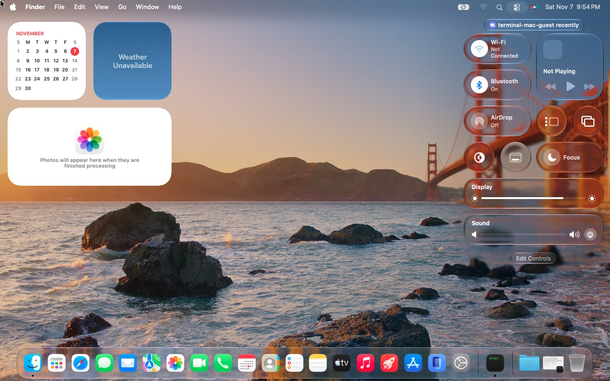
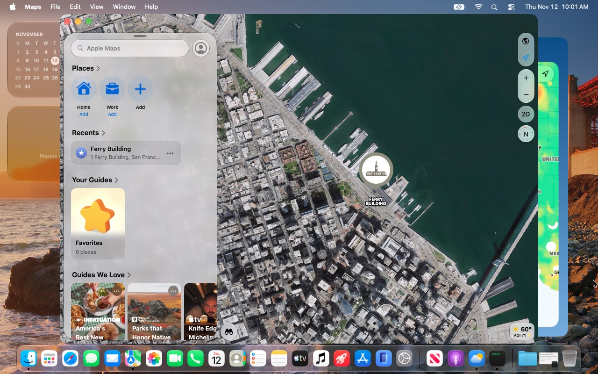
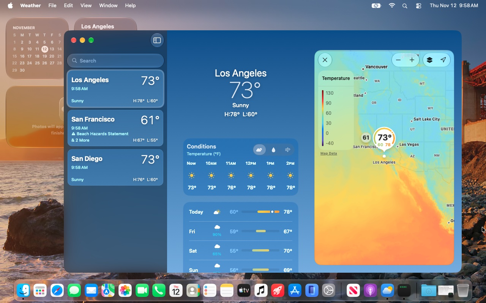

# hao-patcher

For owners of a 2012 13-inch MacBook Pro: run **macOS 27 (Golden Gate)** on it, installed from a USB installer you make on any Mac.

macOS 27.2.1 (26B131). Developer preview, for a test Mac only.

macOS 27 does not support Intel Macs, so the image is built in layers: Golden Gate's own System and Data, the Intel
kernel extensions, drivers and boot files macOS 26 (Tahoe) still ships, legacy hardware support from OpenCore Legacy
Patcher, a set of compatibility fixes, and [hao-runtime](https://github.com/lythka/hao-runtime), which runs Golden
Gate's ARM-only programs on the Intel CPU.



[Gallery](docs/gallery.md) · [Progress](docs/progress.md) · [Building](docs/building.md) ·
[Buy me a coffee](https://buymeacoffee.com/lythka)

### Accelerated Metal on the Intel HD 4000

Maps draws its satellite view and 3D buildings with Apple's shader libraries, repaired so the HD 4000's legacy Metal
compiler accepts them ([cache/metallib](cache/metallib)). Weather's maps need argument buffers and ASTC textures,
which that legacy stack lacks; hao-patcher adds both to the shader compiler and the driver
([tools/metal-argbuf](tools/metal-argbuf)):

<p>


</p>

More in the [gallery](docs/gallery.md): Safari and YouTube, the wind and air-quality maps, WebGPU and SceneKit.

## Status

Developer preview. Developed and tested on a 2012 13-inch MacBook Pro (MacBookPro9,2: Ivy Bridge, Intel HD 4000); other
Intel Macs are untested. Tested with macOS 27.2.1 (26B131).

| Area | What works |
|---|---|
| Startup | Apple logo only; screen on about 35 s after the kernel starts; Setup Assistant, account creation, automatic login. The first start-up after installing stays busy for several minutes |
| Speed | The system's shared cache is rebuilt for this Mac during installation: Maps opens in about 15–22 s instead of 60–70 s, the Control Center panel in under 2 s |
| Desktop | Menu bar, Dock, Finder, Liquid Glass, Control Center, Spotlight indexing, login window, lock screen |
| Graphics | Accelerated Metal on the HD 4000, argument buffers, ASTC textures, hardware video decoding (YouTube 1080p) |
| Connectivity | Wi-Fi (joins from Setup Assistant and System Settings, remembered networks at startup), Ethernet, Bluetooth, AirDrop, AirPlay display discovery, sound on AirPlay speakers |
| Audio and input | Speakers, camera and microphone, brightness keys, keyboard backlight, built-in keyboard and trackpad; external USB keyboard and mouse |
| Power and ports | Sleep and wake (including the lid), battery level and charging, USB 3 at USB 3 speed, SD card slot |
| Apps | Safari (YouTube, WebGPU), Maps (3D globe, satellite, 3D buildings), Weather (forecasts; temperature, air-quality and wind maps), Photos, TV, Podcasts, Calendar, Preview, App Store, Chess, Books, News, Stocks, Terminal, System Settings |
| 3D | SceneKit scenes with materials, shadows and reflections; Quick Look and Preview open SceneKit scenes |
| Accounts | Apple Account sign-in in Setup Assistant |
| ARM-only programs | macOS 27's ARM-only programs run on the Intel CPU through hao-runtime |

**Releases:** the current release is v0.0.1-beta.1; [Releases](https://github.com/lythka/hao-patcher/releases) (each links its known issues); planned versions are the
[milestones](https://github.com/lythka/hao-patcher/milestones). [Progress](docs/progress.md) has the detailed lists and every fix.

## Risks

**Reduced security.** hao is a developer preview with reduced security: it is not as secure as macOS on a supported Mac. System Integrity Protection is partly off, Apple Mobile File Integrity (code-signature enforcement) is relaxed, and the sealed system volume and Secure Boot are off. Install it only on a Mac that holds nothing you need to protect.

Use hao-patcher only on a **dedicated test Mac** whose contents you can lose.

- Installing an image overwrites the whole target disk.
- [docs/security.md](docs/security.md) lists each security change; report a vulnerability privately ([SECURITY.md](SECURITY.md)).
- hao-runtime changes System files in place and has no uninstaller; see its
  [Read first](https://github.com/lythka/hao-runtime#read-first). Its binary translation is experimental and can
  crash programs or damage their data.
- To recover: hold Option at startup and boot another disk or Internet Recovery (Command-Option-R), reset NVRAM
  (Command-Option-P-R), then erase the disk and reinstall a supported macOS or restore a backup.

## Install

On a Mac, Intel or Apple silicon, running macOS 13 or newer (not one already running hao), with a USB drive of at
least 64 GB and about 26 GB free, run one command. No clone, Xcode or Python installation is needed: the release
supplies its own tools.

```sh
curl -fsSL https://github.com/lythka/hao-assets/releases/download/27.2.1-26B131.1/hao -o hao && sh hao
```

Choose the target Mac and USB drive, confirm, and enter your password when asked.
Making the installer takes about 25 minutes after the downloads (more than 20 GB). This first preview is not signed:
`hao` says so and checks every file against the release's checksums.
Boot the MacBook Pro from **EFI Boot**, then run `/Volumes/HAO/install` in Recovery's
Terminal. For a problem, run `hao report` on the installed Mac or `sh hao report`
on the build Mac. [Requirements and steps](docs/install.md).

## Building

For developers: [Building an image](docs/building.md) covers the inputs, what the build does and testing in QEMU;
[architecture](docs/architecture.md) explains how the pieces fit, and [CONTRIBUTING.md](CONTRIBUTING.md) the tests
and conventions. To change a fix, follow its
[worked example](CONTRIBUTING.md#worked-example-one-recipe-change-clone-to-pull-request), which goes from a clean clone to a pull request.

| Path | Contents |
|---|---|
| `pipeline/` | Image assembly, input rows, targets and patch sets |
| `patches/` | Installation recipes, one folder per fix ([catalog](docs/PATCHES.md)) |
| `tools/` | Fix builders, input preparation, image and QEMU tools |
| `cache/` | Metal library and shader generators |
| `docs/` | Status, architecture, inputs and build guide |

## Credits

Built on [OpenCore Legacy Patcher](https://github.com/dortania/OpenCore-Legacy-Patcher),
[OpenCore](https://github.com/acidanthera/OpenCorePkg),
[Lilu](https://github.com/acidanthera/Lilu),
[MacKernelSDK](https://github.com/acidanthera/MacKernelSDK),
[MetallibSupportPkg](https://github.com/dortania/MetallibSupportPkg),
[Apple's XNU sources](https://github.com/apple-oss-distributions/xnu) and
[QEMU](https://www.qemu.org/). Each tool's NOTICE.md lists the third-party source it carries.

This product includes software developed by Dortania and the OpenCore Legacy
Patcher contributors.

## License

Original code is available under the [MIT license](LICENSE). Third-party code and
Apple components keep their own terms; see [NOTICE.md](NOTICE.md).
