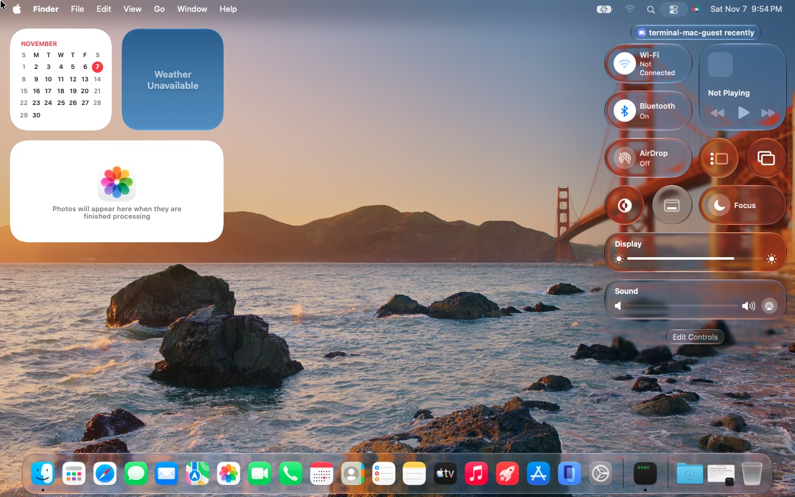
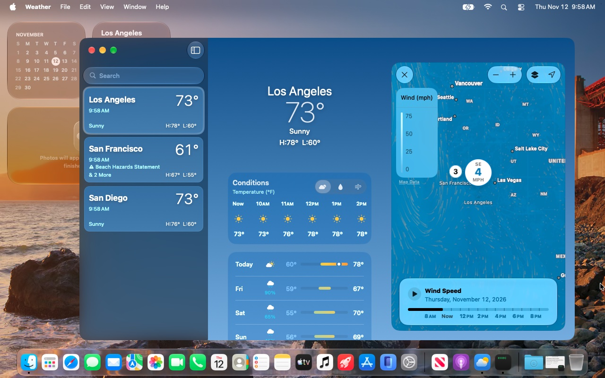
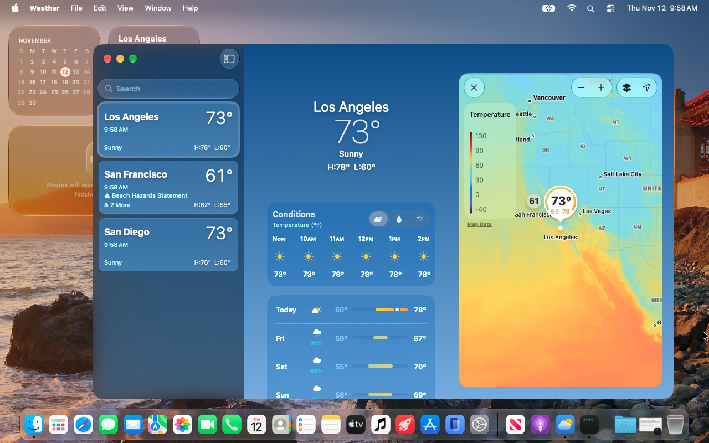
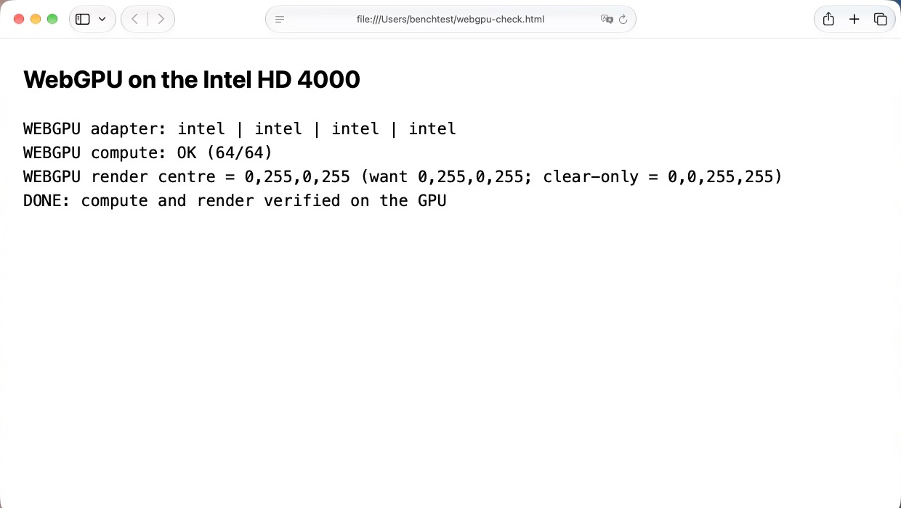

# hao-patcher

hao-patcher builds disk images of **macOS 27 (Golden Gate) for Intel x86_64 Macs**. The current build is
macOS 27.2.1 (26B131).

macOS 27 does not support Intel Macs, so the image is built in layers: Golden Gate's own System and Data, the Intel
kernel extensions, drivers and boot files macOS 26 (Tahoe) still ships, legacy hardware support from OpenCore Legacy
Patcher, a set of compatibility fixes, and [hao-runtime](https://github.com/lythka/hao-runtime), which runs Golden
Gate's ARM-only programs on the Intel CPU.



[Gallery](docs/gallery.md) · [Progress](docs/progress.md) · [Building](docs/building.md) ·
[Buy me a coffee](https://buymeacoffee.com/lythka)

### Metal argument buffers on the Intel HD 4000

The HD 4000's legacy Metal stack has no argument buffers or ASTC textures, which Weather's maps, Safari's WebGPU,
SceneKit and Apple's effects engine need. hao-patcher adds both to the shader compiler and the driver
([tools/metal-argbuf](tools/metal-argbuf)):

<p>


</p>



More in the [gallery](docs/gallery.md): the desktop, Safari and YouTube, the air-quality map, Maps in 3D and SceneKit.

## Status

Experimental. Developed and tested on a 2012 13-inch MacBook Pro (MacBookPro9,2: Ivy Bridge, Intel HD 4000); other
Intel Macs are untested. Tested with macOS 27.2.1 (26B131); "next image" means built, not yet tested on hardware.

| Area | State | Notes |
|---|---|---|
| Startup and Setup | Works | Screen on about 45 s after the kernel starts; Setup, account creation and automatic login. First login is slow (next image preloads the account template) |
| Desktop | Works | Menu bar, Dock, Finder, Liquid Glass, login window, lock screen. The lock screen can lose the wallpaper |
| Graphics | Works | Accelerated HD 4000 Metal, argument buffers and ASTC textures; hardware video decoding (YouTube 1080p) |
| Wi-Fi | Works | Joining from Setup or Settings; remembered networks join automatically, also at startup |
| Audio, input, Bluetooth | Works | Speakers, brightness, keyboard, trackpad, Bluetooth; AirPlay displays are discovered |
| Control Center and widgets | Broken | Regression in recent hao-runtime builds (worked up to 7415a0b); being fixed |
| Safari | Works | Browsing, YouTube, WebGPU. WebGL is in progress |
| Maps | Works | Tiles, search, place cards, location, satellite, 3D globe and buildings |
| Weather | Works | Including its maps (the next image installs this fix) |
| Photos | Works | Import, thumbnails, full-size view. Live Text is in progress |
| SceneKit | Works | 3D scenes with materials, shadows and reflections; Preview opens scenes |
| Other apps | Works | Calendar, Terminal, System Settings, Preview, App Store, Books, Calculator, Automator, Stocks, News; Home and Freeform open |
| Spotlight | Partial | Opens and searches; app results rank below web results (the next image lets it download its data) |
| AirDrop | Partial | The next image stops the mDNSResponder crash; finding nearby devices is not confirmed |
| ARM-only programs | Works | Run on the Intel CPU through hao-runtime, at about 1/2 to 1/3 of native speed |
| Sleep and updates | Not tested | |

[Progress](docs/progress.md) has the detailed lists, what's new and every fix.

## Risks

Use hao-patcher only on a **dedicated test Mac** whose contents you can lose.

- Installing an image overwrites the whole target disk.
- The image weakens macOS security on purpose: AMFI is off, SIP is lowered and authenticated root is off
  (`csr-active-config` 0x803), Secure Boot is disabled, System programs are re-signed ad hoc, and OpenCore loads
  third-party kexts.
- hao-runtime changes System files in place and has no uninstaller; see its
  [Read first](https://github.com/lythka/hao-runtime#read-first). Its binary translation is experimental and can
  crash programs or damage their data.
- To recover: hold Option at startup and boot another disk or Internet Recovery (Command-Option-R), reset NVRAM
  (Command-Option-P-R), then erase the disk and reinstall a supported macOS or restore a backup.

## Requirements

- **Target:** an Intel x86_64 Mac.
- **Build host:** an Apple silicon Mac with the Xcode command-line tools, Python 3.14 and an arm64 macOS virtual
  machine for disk operations.
- **Inputs:** the macOS 27.2.1 (26B131) IPSW, the Tahoe 25G342 installer and Kernel Debug Kit, OCLP support files
  and a hao-runtime payload ([Build inputs](docs/inputs.md)). Apple's files are not included: you supply them.

There is no end-user installer yet; the `hao` command ([tools/hao](tools/hao)) is its start.

## Building

```sh
git clone https://github.com/lythka/hao-patcher.git
cd hao-patcher
# Prepare the inputs (docs/inputs.md), then:
python3.14 -I pipeline/build mbp92-26B131 --repo /path/to/new-image-repository
```

`mbp92-26B131` is the end-user build; `dev-26B131` adds root SSH and diagnostics for testing.
[Building an image](docs/building.md) covers the inputs, what the build does and testing in QEMU;
[architecture](docs/architecture.md) explains how the pieces fit, and [CONTRIBUTING.md](CONTRIBUTING.md) the tests
and conventions.

| Path | Contents |
|---|---|
| `pipeline/` | Image assembly, input rows, targets and patch sets |
| `patches/` | Installation recipes, one folder per fix ([catalog](docs/PATCHES.md)) |
| `tools/` | Fix builders, input preparation, builder VM, image and QEMU tools |
| `cache/` | Metal library and shader generators |
| `docs/` | Status, architecture, inputs and build guide |

## Credits

Built on [OpenCore Legacy Patcher](https://github.com/dortania/OpenCore-Legacy-Patcher),
[OpenCore](https://github.com/acidanthera/OpenCorePkg),
[Lilu](https://github.com/acidanthera/Lilu),
[MacKernelSDK](https://github.com/acidanthera/MacKernelSDK),
[MetallibSupportPkg](https://github.com/dortania/MetallibSupportPkg),
[Apple's XNU sources](https://github.com/apple-oss-distributions/xnu) and
[QEMU](https://www.qemu.org/). Each tool's NOTICE.md lists the third-party source it carries.

This product includes software developed by Dortania and the OpenCore Legacy
Patcher contributors.

## License

Original code is available under the [MIT license](LICENSE). Third-party code and
Apple components keep their own terms; see [NOTICE.md](NOTICE.md).
