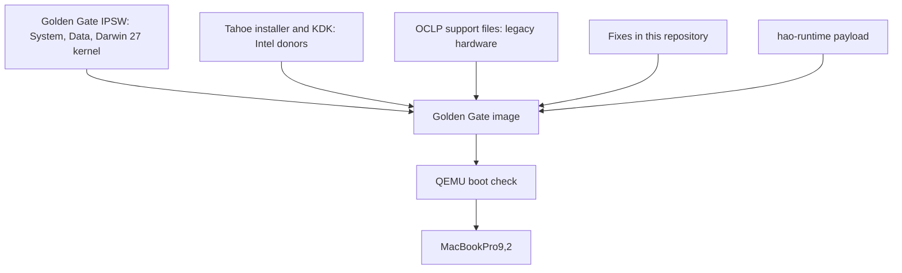

# Architecture

hao-patcher builds one disk image from several sources. Golden Gate is the installed
system. Tahoe, OCLP and this repository's fixes add what an Intel Mac needs.

## The installed system

| Component | Source |
|---|---|
| Kernel, System and Data volumes, applications | Golden Gate 26A428 IPSW |
| Native Intel frameworks | Golden Gate's Intel (Rosetta) shared cache, with targeted fixes |
| Kernel extensions | Tahoe installer extension tree with the KDK's Intel binaries and OCLP replacements |
| DriverKit runtime, extensions and dyld cache | Tahoe installer and SystemOS |
| HID and other native plugins, WindowServer launcher, airportd, disk-image services | Tahoe installer |
| Graphics and compiler framework bases | Tahoe, then OCLP overlays |
| Legacy graphics, wireless and audio drivers | OCLP PatcherSupportPkg |
| Boot files and Recovery | Tahoe boot and Recovery files, OpenCore |
| Compatibility fixes | `patches/`, built by `tools/` and `cache/` |
| ARM-only programs | hao-runtime payload |

Tahoe's kernel and kernel collections are not installed. The builder rebuilds the
collections around the Darwin 27 kernel, using Tahoe's `kmutil` as a build tool.
Every kernel interface that Golden Gate userspace calls is therefore served by a
Tahoe kernel extension; the kernel fixes adapt the differences.

Golden Gate ships many programs only for ARM. The hao-runtime payload installs
`hao`, embeds an x86_64 launch stub into each ARM-only system program, and adds the
`HaoExec` kernel extension so that any other ARM-only program is routed through
`hao`. Native framework calls go to the Intel frameworks.

## The builder

The host selects inputs and source revisions, and records their identities. An
isolated arm64 macOS VM does all formatting, file installation, kernel-collection
builds and snapshot creation. The host then exports the stopped image and commits it
to an image repository. Each build keeps a record of its inputs, patch plan and logs.

Fixed base layers come first (Golden Gate System and volumes, Tahoe and KDK Intel
kexts, the kernel file, Tahoe native roots, boot files, OCLP's hardware overlay; see
[Layer order](building.md#layer-order)). Patches then run exactly in the order listed in
their set (`pipeline/sets/`), by stage:

| Stage | When it runs |
|---|---|
| `oclp-hook` | `src/kc-hook.sh`, after the base layers, in set order; `darwin27-kernel` and `golden-gate-userspace` always first |
| `post` | After the system snapshot, with the System volume read-only |
| `recovery` | In the offline Recovery build |

The stage name `oclp-hook` comes from the older Tahoe-first runner, where these
scripts ran as hooks of OCLP's root patcher (`hook.sh`); Golden Gate sets do not use
`hook.sh`.

## What the image leaves out

The image contains no pre-rendered shader, icon or Swift caches, no captured
account state and no development services. It keeps the operating system's own
library caches (dyld and DriverKit), the kernel collections and the repaired Metal
libraries, because the system needs them to run.
