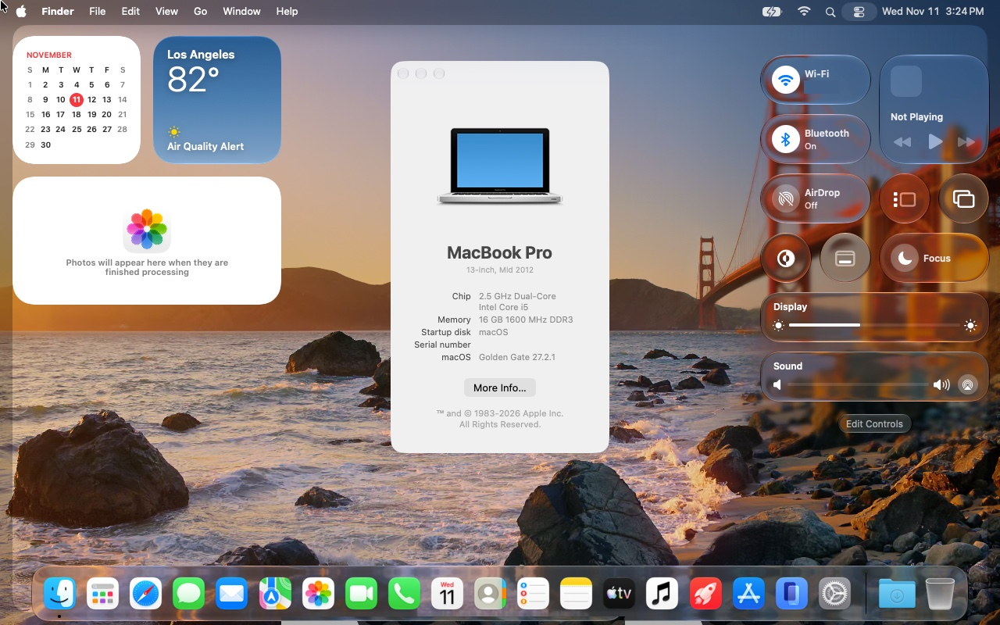
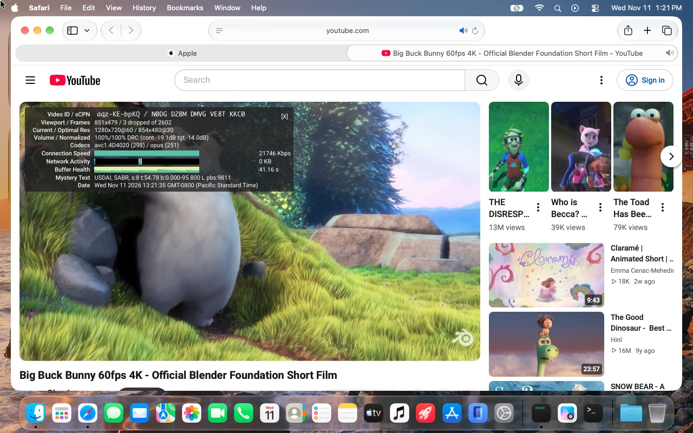
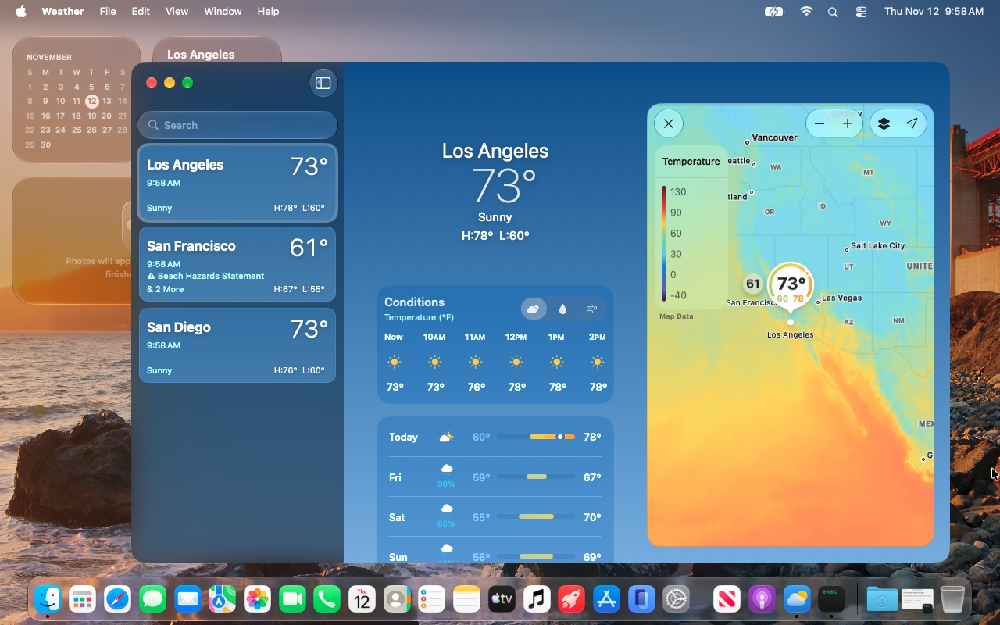
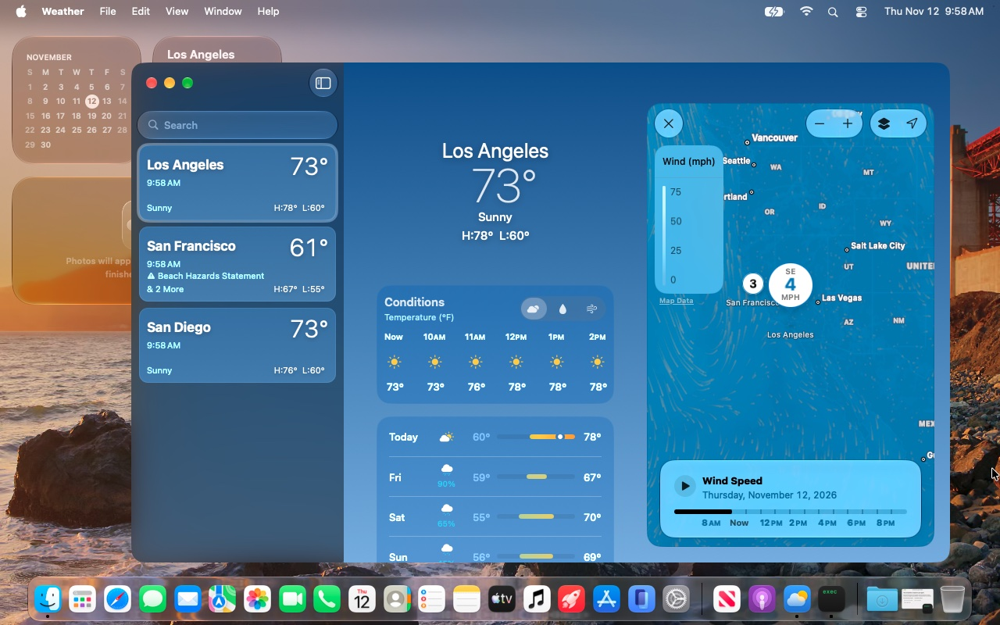
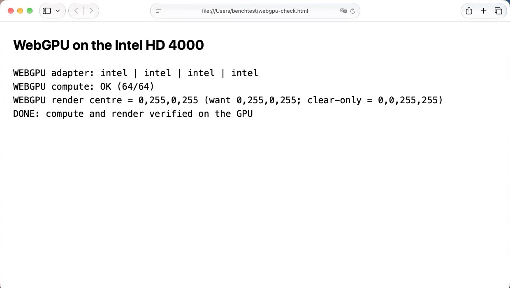
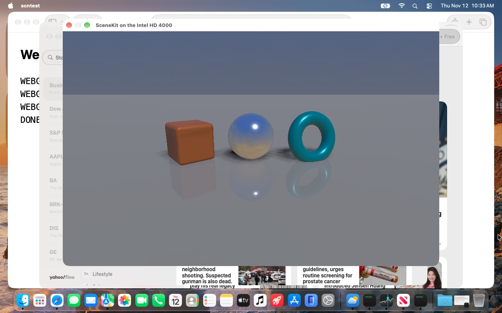

# Gallery

macOS 27.2.1 (26B131) on the development platform, a 2012 MacBook Pro (Intel HD 4000), 2026-11-11 and 11-12. Weather and
WebGPU need Metal argument buffers and ASTC textures, which the HD 4000's legacy Metal stack does not provide;
[tools/metal-argbuf](../tools/metal-argbuf) implements them in the shader compiler and the driver. Maps and SceneKit
need their shader libraries repaired for the old compiler ([cache/metallib](../cache/metallib)).

## The desktop

About This Mac, Control Center and the desktop widgets (the Wi-Fi network name is hidden):

## Safari

apple.com:

YouTube in 720p60 with hardware video decoding (Stats for nerds: 3 dropped frames of 2602):

## Weather

The temperature, wind and air-quality maps:

## Maps

Satellite imagery with 3D buildings, San Francisco:

## WebGPU in Safari

A compute shader and a render pass, read back and checked
([probes/webgpu-check.html](../tools/metal-argbuf/probes/webgpu-check.html)):

## SceneKit

A small SceneKit test scene: physically based materials, a cube-map environment (reflected in the chrome
sphere), shadows and floor reflections:

