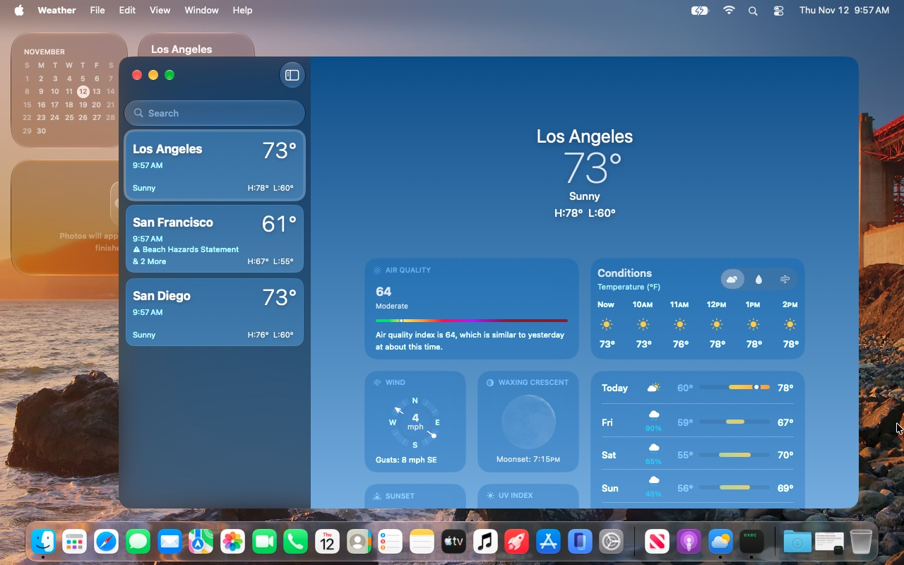
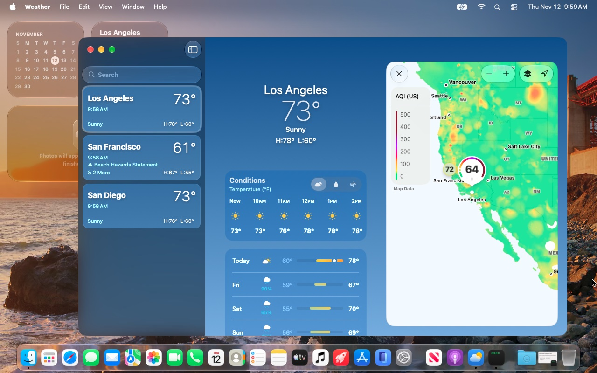
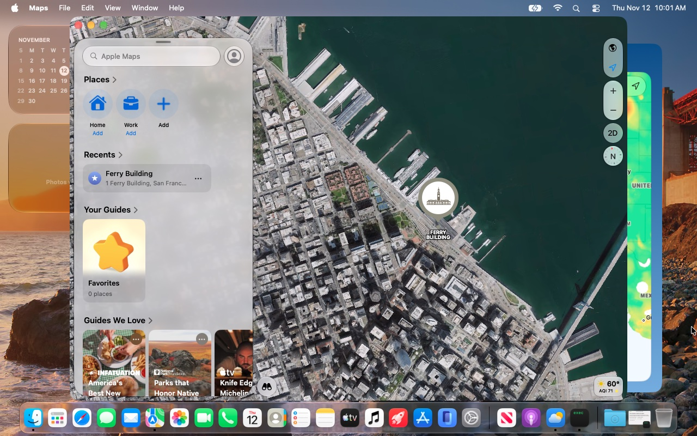

# Gallery

macOS 27.2.1 (26B131) on the development platform, a 2012 MacBook Pro (Intel HD 4000), 2026-11-12. These views
need Metal argument buffers and ASTC textures, which the HD 4000's legacy Metal stack does not provide;
[tools/metal-argbuf](../tools/metal-argbuf) implements them in the shader compiler and the driver.

## Weather

The temperature, wind and air-quality maps:

## Maps

Satellite imagery with 3D buildings, San Francisco:

## WebGPU in Safari

A compute shader and a render pass, read back and checked
([probes/webgpu-check.html](../tools/metal-argbuf/probes/webgpu-check.html)):

